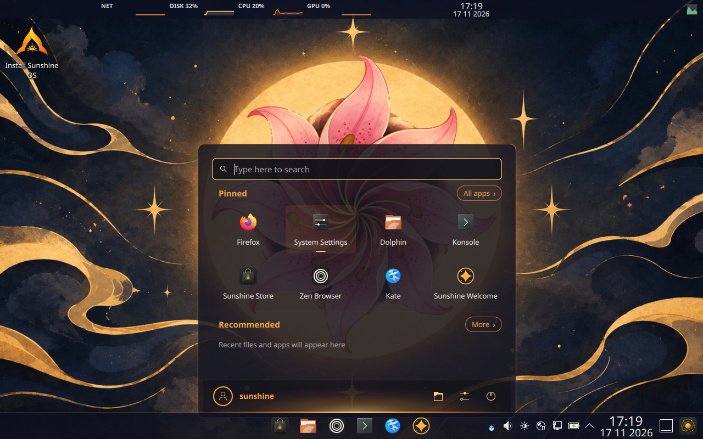

# Sunshine OS assets

The visual side of Sunshine OS: the Plasma theme, start menu, top-bar widgets, window decoration, Kvantum style, colour scheme, splash
(look-and-feel) and the default visual configs (kwin, GTK, Kando, Kate, terminals).

    share/   goes to ~/.local/share/   (plasma/desktoptheme, plasma/plasmoids, plasma/look-and-feel, aurorae/themes, Kvantum, color-schemes)
    config/  goes to ~/.config/        (kwinrc, kdeglobals, plasmarc, ksplashrc, kglobalshortcutsrc, gtk-3.0, gtk-4.0, kando, ...)

`sunshine-restore-visuals` (the "Restore visuals" button in Sunshine Welcome) pulls this repository and applies it; offline it applies what is
installed. This repository is generated from the Sunshine OS sources (`tools/publish-assets.sh`); change things there.
Theme base: Win11OS-kde by yeyushengfan258 (GPL-3.0), icons: Fluent icon theme by vinceliuice (GPL-3.0). Licence: GPL-3.0-or-later.

